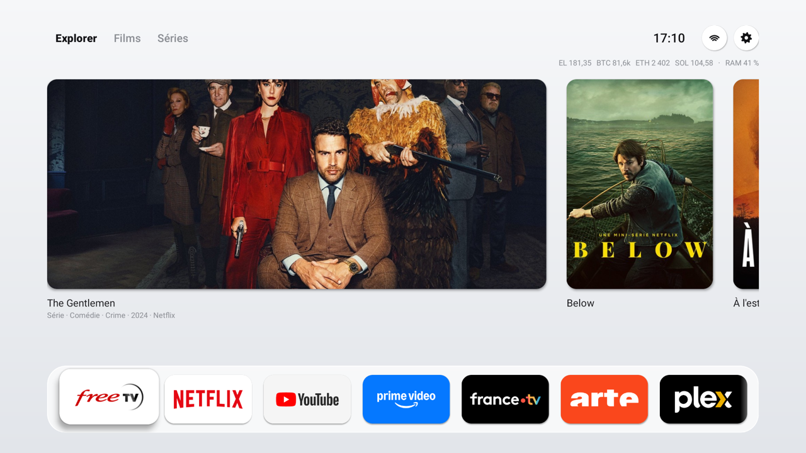
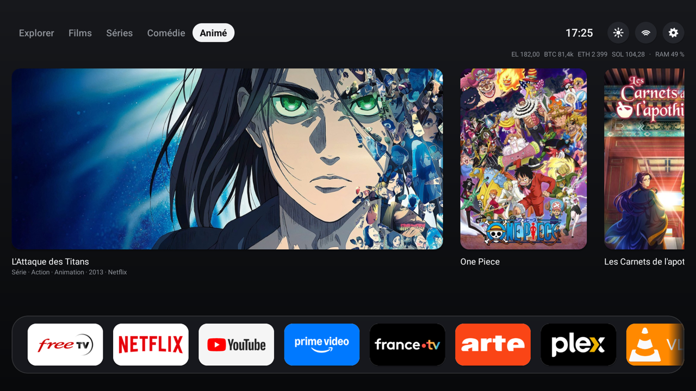

# Mi Box Launcher

A lightweight, Apple TV-inspired home screen for **Android TV** boxes (tested on a Xiaomi Mi Box S, Android 9).
It replaces the Google TV home screen, removes ads and recommendations, and makes an old box feel fast again.
It also runs on **LG TVs** (webOS) as an app: see [LG TVs](#lg-tvs-webos).
The interface is in French.

| Light mode | Dark mode |
|---|---|
|  |  |

## Features

- **Netflix posters**: what's popular on Netflix France, in tabs *Explorer*, *Films*, *Séries*, *Comédie* (French comedies) and *Animé* (Japanese anime). One click opens **the title directly in Netflix**. The lists come from [JustWatch](https://www.justwatch.com) and refresh every 6 hours.
- **App dock** at the bottom, in frosted glass. Installed apps are added automatically.
- **Info line** at the top right: time, EssilorLuxottica (EL), Bitcoin, Ethereum and Solana prices (every 5 minutes) and RAM usage in %.
- **Dark / light mode** with the moon / sun button (the choice is remembered).
- Wi-Fi and Settings buttons.
- No ads, no trackers, no account. A single ~40 KB app in plain Java, with no libraries.

> Prices and rankings are for information only.

---

## Install it on your box

You need a **computer** (Mac, Linux or Windows) on **the same Wi-Fi** as the box.

### 1. Turn on developer mode on the box

1. On the box: **Settings → Device Preferences → About**.
2. Scroll to **Build** and press it **7 times** with the remote. A message says you are now a developer.
3. Go back to **Device Preferences → Developer options** and turn on **USB debugging** (and **Network debugging** if it exists).
4. Write down the box's **IP address**: **Settings → Network → your Wi-Fi** (something like `192.168.1.75`).

### 2. Install ADB on the computer

- **Mac**: `brew install --cask android-platform-tools`
- **Linux**: `sudo apt install adb`
- **Windows**: download the [Platform Tools](https://developer.android.com/tools/releases/platform-tools) and open a terminal in that folder.

### 3. Connect to the box

```bash
adb connect 192.168.1.75:5555
```

The TV shows **"Allow USB debugging?"**: tick *Always allow* and confirm. Then check:

```bash
adb devices
```

The box should be listed with `device` next to it.

### 4. Install the launcher

Download `TvHome.apk` from the [**Releases**](../../releases/latest) page, then:

```bash
adb install -r TvHome.apk
```

### 5. Make it the home screen

Disable the Google home screen (reversible) so the new one takes over:

```bash
adb shell pm disable-user --user 0 com.google.android.tvlauncher
adb shell input keyevent KEYCODE_HOME
```

Done 🎉

### 5b. On a **Google TV** box (Android 12+, e.g. Thomson 240G, Chromecast with Google TV)

On Google TV, **do not disable** the Google home screen: a protected fallback screen relaunches in a loop (black screen).
If that happens: `adb shell pm enable com.google.android.apps.tv.launcherx`.

Instead, turn on the launcher's small accessibility service, which replaces the Google home screen as soon as it appears:

```bash
adb shell settings put secure enabled_accessibility_services fr.sacha.tvhome/.HomeRedirectService
adb shell settings put secure accessibility_enabled 1
adb shell input keyevent KEYCODE_HOME
```

The service only watches for the Google home screen appearing (nothing else: no text, no key presses).
To remove it: `adb shell settings put secure enabled_accessibility_services ""`.

---

## LG TVs (webOS)

The same home screen as an LG web app, in [`webos/`](webos): the Netflix tabs, the info line, light and dark, and the dock of the TV's apps. LG doesn't let an app replace its home screen, so it stays an app: **hold a number key** on the remote while it's open, and that key opens it from anywhere. Tested on webOS 6.5.

You need **Python 3** and **OpenSSH** (already on macOS, Linux and Windows 10+) on a computer on the same Wi-Fi.

1. **On the TV**: LG Content Store → install **Developer Mode** → sign in with a free [LG developer account](https://webostv.developer.lge.com) → turn on **Dev Mode Status** (the TV restarts) → turn on **Key Server**. Write down the IP address and the passphrase it shows.
2. **On the computer**, build and install (the first time, it asks for the TV's passphrase):
   ```bash
   python3 webos/install.py 192.168.1.120
   ```
3. **On the TV**, the first time, a message asks whether to allow the app: allow it. The dock then shows all your apps, and the app becomes the TV's home: it comes back when you press **Home** (LG's home shows for about a second first: taking over sooner makes the two swap back and forth) and when the TV turns on. To stay on LG's own home screen, press **Home again** right after this one comes back.

LG gives these events to a Developer Mode app only through its remote control API (the one LG's phone app uses), so a small service on the TV watches it while the app is running in the background. After the TV restarts from the mains (not from standby), open the app once with its number key. Keep **Quick Start+** on (Settings → General → Devices → TV Management): the TV then only sleeps when turned off, and turning it on is detected.

**Find a film from your phone.** The 📱 button at the top shows a QR code: scan it on the home Wi-Fi, describe a film or a show (even vaguely: "the series with the lawyer who never went to law school"), and the TV opens it: the title itself in Netflix, the app's home for other services. The TV serves that page itself (port 8090); Claude names the title on a server of yours, through your Claude subscription ([`server/tvhome_ai.py`](server/tvhome_ai.py)), and JustWatch says where it streams in France. To set it up on a server where Claude Code is installed:

```bash
scp server/tvhome_ai.py you@server:tvhome-ai/
ssh you@server 'cd tvhome-ai && python3 tvhome_ai.py --setup' > webos/ai.local.json   # address, token, certificate
ssh -t you@server 'sudo ufw allow 8791/tcp && claude auth login'
ssh you@server 'cd tvhome-ai && nohup python3 tvhome_ai.py >> server.log 2>&1 &'      # and @reboot in crontab
python3 webos/install.py 192.168.1.120                                                 # the TV gets the new settings
```

The token and certificate stay in `webos/ai.local.json` (not in git); the TV pins that certificate. The server answers 30 searches an hour at most.

Developer Mode lasts about 40 days: open the Developer Mode app now and then and press **EXTEND** (if it runs out, the TV removes the app; installing again brings it back). To remove it: `python3 webos/install.py 192.168.1.120 --uninstall`.

How it works: [`webos/app/`](webos/app) is the screen (plain HTML, CSS and ES5), and a small JS service ([`webos/service/`](webos/service)) does what an LG web page can't: the JustWatch and Yahoo Finance requests, the RAM figure, the TV's app list, and the Home / power-on watcher. A 4K LG draws apps at twice their size, so only transforms and opacity animate (56 fps on the dock, 53 on the posters, webOS 6.5). `luna-send-pub luna://com.webos.applicationManager/launch '{"id":"fr.sacha.tvhome","params":{"perf":"test"}}'` runs a speed test on the TV; `luna://fr.sacha.tvhome.service/dump` reads its numbers and the watcher's events. `webos/build.py` packs the `.ipk` without LG's tools; `--preview` also writes `webos/out/` to open in a browser. The dock uses the Mi Box's wide logos from `launcher/assets/demo/` when you have them (they are not in the repo); otherwise, the TV's own app icons. The LG packaging, installer and app list call are adapted from [Free My TV](https://github.com/simbasjungles/free-my-tv) (MIT).

---

## Bonus: clean up and speed up the box (optional)

Everything is **reversible** (a factory reset also restores everything).

```bash
# Animations twice as fast
adb shell settings put global window_animation_scale 0.5
adb shell settings put global transition_animation_scale 0.5
adb shell settings put global animator_duration_scale 0.5

# Remove the Alphonso ad tracker and the ads/recommendations
adb shell pm uninstall --user 0 tv.alphonso.alphonso_eula
adb shell pm uninstall --user 0 com.google.android.tvrecommendations
```

The [`launcher/restore-mibox.sh`](launcher/restore-mibox.sh) script does it all at once (install, home screen, full cleanup of a **Mi Box S**). Read the app list inside before running it: it also removes the built-in Chromecast and the voice assistant.

```bash
./launcher/restore-mibox.sh 192.168.1.75
```

It looks for `TvHome.apk` in its own folder (`launcher/`). It is also useful if an update brings the old home screen back.

## Undo

```bash
adb shell pm enable com.google.android.tvlauncher
adb uninstall fr.sacha.tvhome
```

For a removed app: `adb shell cmd package install-existing <package.name>`.
For a disabled service: `adb shell pm enable <package.name>`.

---

## Customize and build it yourself

All the code is in [`HomeActivity.java`](launcher/src/fr/sacha/tvhome/HomeActivity.java):

- **Dock app order**: the `PREFERRED` list.
- **Tabs**: the `TABS` / `TAB_FILTERS` arrays (JustWatch filters: genres, production countries, movies/shows).
- **Margins**: if your TV crops the edges or leaves too much room (overscan), set the side margin without rebuilding (remembered on the box):
  `adb shell am start -n fr.sacha.tvhome/.HomeActivity --ei side_margin 32` (16 by default).

Build (no Gradle). Requirements on a Mac:

```bash
brew install openjdk@17
brew install --cask android-commandlinetools
sdkmanager "build-tools;34.0.0" "platforms;android-28"
./launcher/build.sh
```

`build.sh` uses Homebrew paths; adjust `JAVA_HOME` and `SDK` at the top of the file on another machine.
It generates a local signing key on first run.

## License

[MIT](LICENSE)
